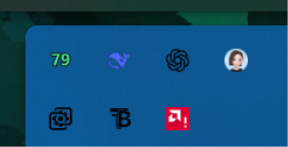
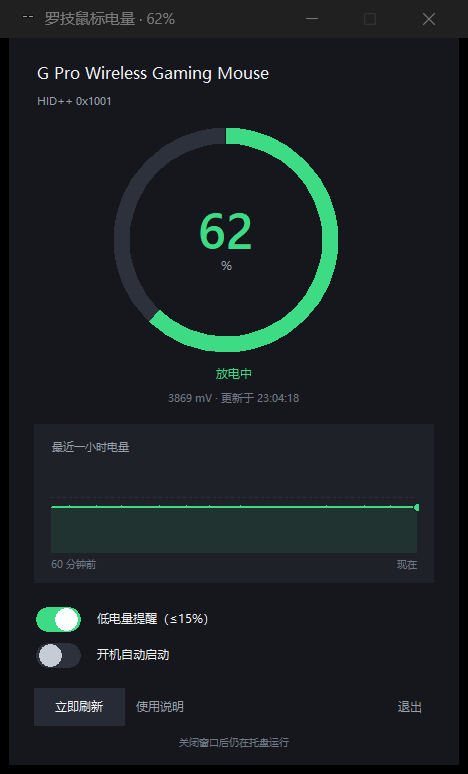
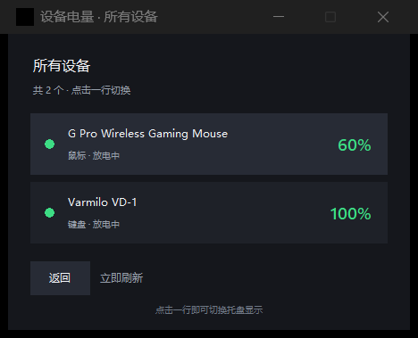

# 设备电量 · GProBattery

在 Windows 托盘里显示罗技鼠标（以及蓝牙键盘/鼠标）的电量，带一个深色面板。
直接通过 HID++ 2.0 跟接收器通信，**不需要安装 Logitech G HUB**，也不改动设备的任何设置。

已在 **G Pro Wireless（GWP）** 上实测：接收器 PID `C539`，读到 `G Pro Wireless Gaming Mouse · 60% · 3860 mV`；
同一台机器上蓝牙键盘 `Varmilo VD-1` 的电量也能一起读出来。



## 安装（推荐）

从 [Releases](https://github.com/lingkele/gwp-battery/releases) 下载 **`GProBattery-Setup.exe`**，双击安装：

- 装到 `%LOCALAPPDATA%\Programs\GProBattery`，**不需要管理员权限**、不弹 UAC；
- 自动创建开始菜单快捷方式（桌面快捷方式、开机自启可在安装界面勾选）；
- 卸载：开始菜单「卸载 设备电量」，或 Windows 设置 → 应用 → 已安装的应用；
- 卸载时可以选择保留设置与电量历史（默认保留）。

不想安装的话，`GProBattery.exe` 是单文件便携版，双击即用。

## 面板

左键单击托盘图标打开面板：

- **详情页**：当前设备的大号电量表盘、最近一小时电量曲线、电压与更新时间；
  下方可以直接勾选低电量提醒、开机自启。
- **所有设备**：列出每个设备的电量（鼠标、键盘、蓝牙设备），点一行就切换托盘显示哪个。




托盘右键菜单里也能直接切换设备、「立即刷新」、切换图标样式（百分比 / 电池图形）、开关低电量提醒和开机自启。

> **看不到图标？** Windows 11 会把新图标放进隐藏区。点任务栏右下角的 `∧`，
> 把图标拖到任务栏上就会常驻。程序首次启动也会弹一次提示并打开面板。

程序是单实例的，重复双击不会再开第二个；关掉窗口后仍在托盘运行。

## 能读到哪些设备

| 设备类型 | 读取方式 |
| --- | --- |
| 罗技无线鼠标（Lightspeed / Bolt / Unifying 接收器） | HID++ 2.0，逐个 device index ping 找出在线设备 |
| 罗技鼠标用 USB 线直连 | 同一条代码路径，device index `0xFF` |
| 蓝牙键盘 / 鼠标（含非罗技品牌） | Windows 缓存的蓝牙电池服务 |

设备的电量优先级尝试：`0x1004` UnifiedBattery → `0x1000` BatteryStatus → `0x1001` BatteryVoltage
（G Pro Wireless 只有 `0x1001`，用锂电放电曲线把大端电压换算成百分比，曲线与 Solaar 一致）。

## 已知限制

- 百分比来自电压换算，和 G HUB 显示的数字可能差 1–3%；
- 接收器不在时托盘显示「未连接」，插回后 5 秒内自动恢复；
- 蓝牙设备的电量是 Windows 缓存值，系统没刷新时会显示旧数据；
- 单文件 exe 首次启动会自解压到 `%TEMP%`，杀毒软件偶尔会多看它一眼。

## 自己构建

需要 Python 3.10+：

```powershell
cd gwp-battery
.\build.ps1
```

脚本会建 `.venv`、装 `hidapi / pillow / pystray / pyinstaller`、生成图标，产出三个文件：

```
dist\GProBattery.exe            便携版（单文件）
dist\GProBatteryUninstall.exe   卸载程序
dist\GProBattery-Setup.exe      安装包（内含上面两个）
```

也可以直接跑源码：

```powershell
.\.venv\Scripts\pythonw.exe app.py
```

## 文件

```
app.py             托盘 UI、轮询、通知、开机自启、设置与电量历史
installer.py       安装包（Tk 界面 + --silent 静默安装）
uninstaller.py     卸载程序（保留设置的选项、延迟自删）
gwp/hidpp.py       HID++ 2.0 传输（短/长报文、feature 发现、ping）
gwp/battery.py     电量解析、电压→百分比曲线、多设备扫描
gwp/devices.py     设备模型：把 HID++ 与蓝牙电池合并成统一列表
gwp/bluetooth.py   CfgMgr32 读 Windows 蓝牙电池属性
gwp/theme.py       颜色分级（绿 / 黄 / 红 / 灰）
gwp/panel.py       桌面面板（Tkinter）：表盘、曲线、所有设备页、开关
tools/             构建、截图与冒烟测试（capture.py 离屏截窗口，panel/click/setup/uninstall_smoke.py）
assets/app.ico     程序图标
build.ps1          一键构建三个 exe
```

设置保存在 `%APPDATA%\GProBattery\settings.json`，最近两天各设备的电量历史在同一目录的
`history.json`（面板里的曲线来自它）。

## 协议参考

- HID++ 2.0 位于接口 2、usage page `0xFF00`：短报文 collection（usage `0x01`）写请求，
  短/长两个 collection 都可能收到回复，所以两个都要读；
- 请求先 ping device index 1–6（直连设备用 `0xFF`）找出在线设备；
- 一个 feature 索引查询超时**不能**当成「不支持」缓存下来，否则一次瞬时丢包会让设备名
  永久读不到——这条踩过坑，`feature_index()` 现在超时只重试不写缓存。
