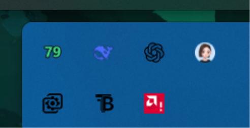

# 罗技鼠标电量托盘 GProBattery

给罗技无线鼠标用的 Windows 托盘电量显示。直接通过 HID++ 2.0 跟接收器通信，
**不需要安装 Logitech G HUB**，也不改动鼠标的任何设置。

已在 **G Pro Wireless（GWP）** 上实测：接收器 PID `C539`，读到
`G Pro Wireless Gaming Mouse · 79% · 3981 mV`。



## 直接使用

从 [Releases](https://github.com/lingkele/gwp-battery/releases) 下载 `GProBattery.exe`
（单文件，16 MB，不需要装 Python），双击运行即可；也可以按下面的「自己构建」从源码打包。

托盘会出现电量图标（数字 = 电量百分比，颜色随电量变化：绿 > 50%，黄 20–50%，红 ≤ 20%）。

- 鼠标悬停：看鼠标型号、电量、充放电状态、电压；
- 左键单击：立即刷新；
- 右键：刷新 / 切换「百分比 ↔ 电池图标」/ 低电量提醒 / 开机自启 / 使用说明 / 退出。

开机自启默认关闭，需要的话在右键菜单里勾选即可（写当前用户启动项，不用管理员）。

> **看不到图标？** Windows 11 会把新图标放进隐藏区。点任务栏右下角的 `∧`，
> 把写着 `79` 的图标拖到任务栏上就会常驻。程序首次启动也会弹一次提示。

程序是单实例的，重复双击不会再开第二个。

## 读数原理

- 鼠标走 Lightspeed / Bolt / Unifying 接收器时，HID++ 位于接口 2、
  usage page `0xFF00`：短报文 collection（usage `0x01`）写请求，
  短/长两个 collection 都可能收到回复，所以两个都要读。
- 先向 device index 1–6 发 root feature 的 ping，找到在线的鼠标；
- 电量特性按优先级尝试：
  1. `0x1004` UnifiedBattery —— 直接给百分比 + 充电状态；
  2. `0x1000` BatteryStatus —— 百分比 + 状态；
  3. `0x1001` BatteryVoltage —— G Pro Wireless 只有这个：大端电压（mV）
     + 标志位，用锂电放电曲线换算成百分比（和 Solaar 同一条曲线）。
- 鼠标休眠时读不到就显示 `--`，每 5 秒重试一次，并用 ping 把它唤醒。

## 自己构建

需要 Python 3.10+。

```powershell
cd gwp-battery
.\build.ps1
```

脚本会建 `.venv`、装 `hidapi / pillow / pystray / pyinstaller`、生成图标，
并在 `dist\GProBattery.exe` 产出单文件程序。也可以直接跑源码：

```powershell
.\.venv\Scripts\pythonw.exe app.py
```

## 兼容性

- G Pro Wireless：实测可用（电压换算百分比）。
- 其它支持 UnifiedBattery 的罗技鼠标（Superlight 等）：走 0x1004，直接读百分比。
- 用 USB 线直连的鼠标，以及 Bolt / Unifying 接收器：同一条代码路径，
  枚举到 HID++ 接口就会尝试。
- 和 G HUB 同时运行不冲突（都是只读查询）。

## 已知限制

- 百分比来自电压换算，和 G HUB 显示的数字可能差 1–2%。
- 接收器不在时托盘显示「未连接」，插回后 5 秒内自动恢复。
- 单文件 exe 首次启动会自解压到 `%TEMP%`，杀毒软件偶尔会多看一眼。

## 文件

```
app.py            托盘 UI、轮询、开机自启、设置
gwp/hidpp.py      HID++ 2.0 传输（短/长报文、feature 发现、ping）
gwp/battery.py    电量解析、电压→百分比曲线
assets/app.ico    程序图标
build.ps1         一键构建
dist/GProBattery.exe
```

设置保存在 `%APPDATA%\GProBattery\settings.json`。
